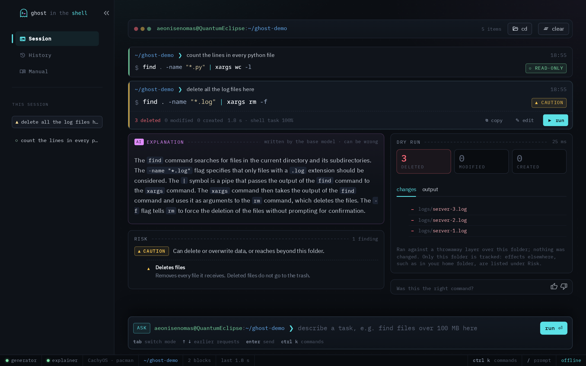
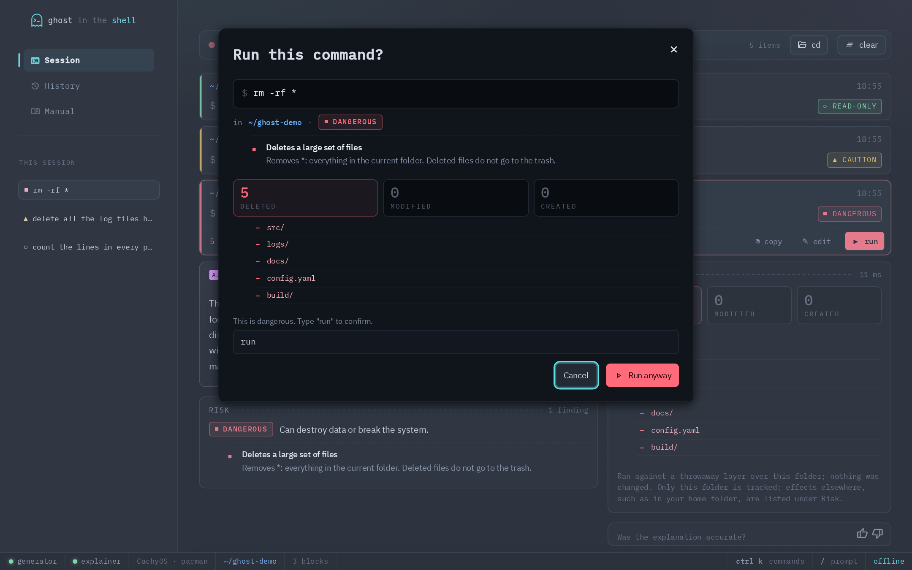
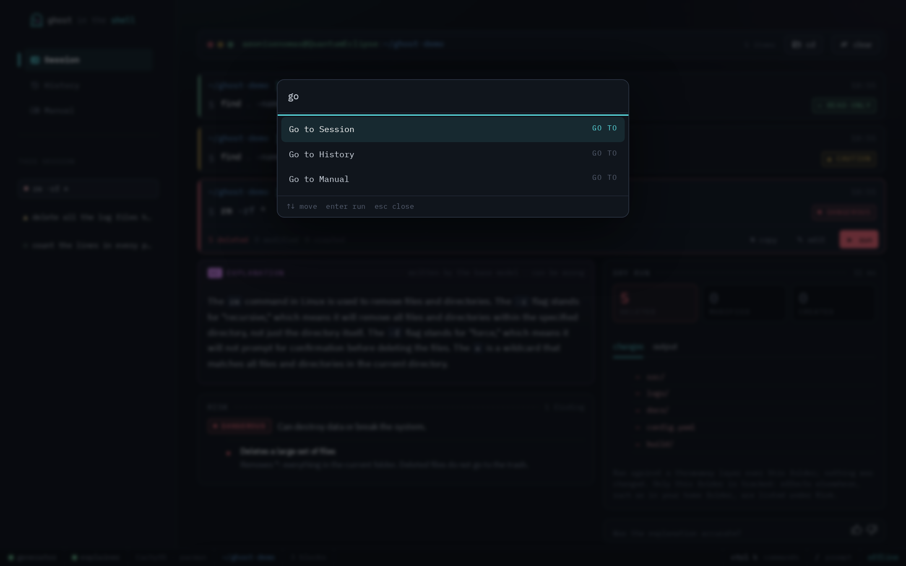
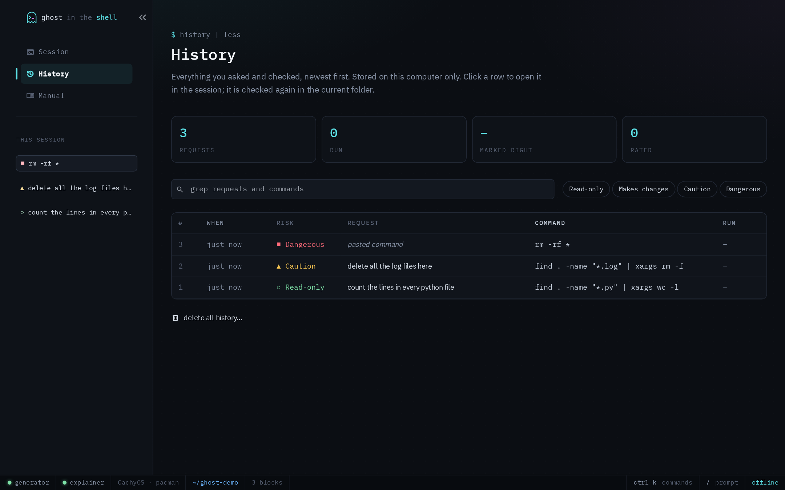
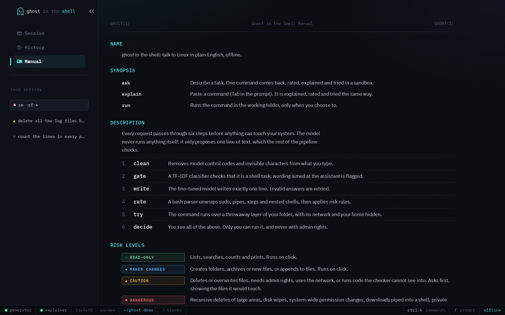

<p align="center">
  
</p>

<h1 align="center">ghost in the shell</h1>

<p align="center">
  Talk to Linux in plain English. Get one command, see exactly what it would do, then decide.<br>
  Runs entirely offline on an ordinary laptop CPU.
</p>

<p align="center">
  
  
  
  
</p>

<p align="center">
  
</p>

## Overview

Ghost in the Shell turns a request such as *"delete all the log files here"*
into a single shell command, and shows you everything you need to decide
whether to run it:

- **the command**, written by a fine-tuned Qwen2.5-Coder-1.5B;
- **what it does**, in plain English, written by a second model;
- **how risky it is**: Read-only, Makes changes, Caution or Dangerous, with
  the reasons, found by parsing the command rather than by asking a model;
- **a dry run** in a sandbox, listing every file the command would create,
  modify or delete, before anything happens to your system.

Nothing runs until you choose to. Dangerous commands need a typed
confirmation, and commands that need administrator rights are never run from
the app.

The project began as an NLP course project ("Fine-tuning small language
models"). The model was chosen through three rounds of execution-based
evaluation on a held-out test set; the full study is in
[`docs/model_selection.md`](docs/model_selection.md).

## Features

| | |
|---|---|
| **Two modes** | *Ask* turns English into a command. *Explain* takes a command you found somewhere and explains, rates and dry-runs it. |
| **Risk rating** | A bash parser unwraps quoting tricks (`r''m`), `sudo`, `env`, `xargs`, `find -exec`, nested shells and pipes into interpreters before applying rules, so a dangerous command cannot hide behind a wrapper. |
| **Dry run** | The command runs with [bubblewrap](https://github.com/containers/bubblewrap) over a throwaway layer of your folder: no network, home folder hidden, the rest of the system read-only, five-second limit. Works on folders of any size. |
| **Run proportional to risk** | Read-only commands run on click; Caution opens a dialog listing the files it touches; Dangerous also needs the word `run` typed. The backend enforces this independently of the interface. |
| **Prompt-injection defences** | Model control tokens and invisible characters are stripped from requests; wording aimed at the assistant ("ignore previous instructions") is flagged; a classifier stops requests that are not shell tasks. |
| **Terminal-native interface** | Session feed of command blocks, explanation streamed as it is written, Ctrl+K command palette, history, a `man`-style manual, keyboard first. |
| **Private by design** | Two local models served by llama.cpp on 127.0.0.1; history in a local SQLite file; no network use at all. |

<table>
  <tr>
    <td width="50%"></td>
    <td width="50%"></td>
  </tr>
  <tr>
    <td width="50%"></td>
    <td width="50%"></td>
  </tr>
</table>

## How it works

```
 request ──► clean ──► gate ──► write ──► validate ──► rate ──► dry run ──► you decide
             │          │         │          │           │          │
             │          │         │          │           │          └ bubblewrap, overlay over the folder,
             │          │         │          │           │            no network, home hidden, 5 s limit
             │          │         │          │           └ bashlex parse, unwrap wrappers, risk rules
             │          │         │          └ bash -n, program installed, right distribution;
             │          │         │            two more samples if the first answer is invalid
             │          │         └ fine-tuned Qwen2.5-Coder-1.5B, constrained to one line
             │          └ TF-IDF + logistic regression: is this a shell task?
             │            plus detection of wording aimed at the model
             └ strip chat control tokens and invisible characters
```

The model never runs anything. It proposes one line of text, and everything
after it is ordinary, testable code. Details, including the threat model and
the interface design, are in [`docs/app.md`](docs/app.md).

## Results

**Model selection.** Eight open models were scored by running their commands
in a sandbox and comparing the effect with the reference answers (275 prompts
from the [NL2SH-ALFA](https://huggingface.co/datasets/westenfelder/NL2SH-ALFA)
test set).

| Model | Execution accuracy | Seconds per answer |
|---|---|---|
| Qwen2.5-Coder-3B | 51.6% | 2.89 |
| Gemma-4-E2B | 49.8% | 2.72 |
| Qwen2.5-Coder-1.5B | 43.6% | 1.60 |
| Llama-3.2-3B | 36.4% | 3.02 |
| Qwen3.5-2B, Qwen2.5-Coder-0.5B, Llama-3.2-1B, Qwen3.5-0.8B | 16.0–34.2% | 0.64–6.12 |

**Fine-tuning.** Both Qwen2.5-Coder finalists were fine-tuned with QLoRA on
10,000 NL2SH-ALFA training pairs. A decision rule was fixed before training:
keep the 3B model only if it beats the 1.5B model by at least 5 points with
p < 0.05.

| | Base | Fine-tuned | McNemar p |
|---|---|---|---|
| Qwen2.5-Coder-1.5B | 43.6% | 46.2% | 0.37 |
| Qwen2.5-Coder-3B | 51.6% | 50.9% | 0.89 |
| 3B vs 1.5B, both fine-tuned | | +4.7 points | 0.06 |

The 3B model missed the rule on both counts, so the app ships the fine-tuned
1.5B model, which is also twice as fast (1.35 s per answer). Fine-tuning
weakened the model's explanations, so explanations come from the base model.

**The app** ([`evaluation/results/report.md`](evaluation/results/report.md)):

- The request gate accepts all 300 test prompts and stops all 30 handwritten
  off-topic requests.
- All 72 destructive commands the models produced on 50 risky prompts are
  rated Caution or Dangerous.
- Of 24 injection and misuse attacks, 11 are stopped before reaching the model;
  every harmful command produced by the rest is rated Caution or Dangerous.
- About 1.6 s per request on a 2014 laptop CPU (i7-4712HQ), of which the dry
  run takes tens of milliseconds.

## How to run

### Requirements

- Linux, with [bubblewrap](https://github.com/containers/bubblewrap) (`bwrap`) and
  [llama.cpp](https://github.com/ggml-org/llama.cpp) (`llama-server`) on the `PATH`
- Python 3.12 or newer and [uv](https://docs.astral.sh/uv/)
- About 3 GB of free memory and 2.5 GB of disk for the models

| Distribution | bubblewrap | llama.cpp |
|---|---|---|
| Arch Linux | `sudo pacman -S bubblewrap` | `sudo pacman -S llama-cpp` |
| Debian, Ubuntu | `sudo apt install bubblewrap` | prebuilt binaries from the [llama.cpp releases](https://github.com/ggml-org/llama.cpp/releases) |
| Fedora | `sudo dnf install bubblewrap` | prebuilt binaries from the [llama.cpp releases](https://github.com/ggml-org/llama.cpp/releases) |

### 1. Get the code and dependencies

```bash
git clone https://github.com/AeonisEnomas/ghost-in-the-shell.git
cd ghost-in-the-shell
uv sync
```

### 2. Get the models

The app needs three files in `models/`.

**The explainer** (base Qwen2.5-Coder-1.5B, about 1.1 GB):

```bash
uv run hf download Qwen/Qwen2.5-Coder-1.5B-Instruct-GGUF qwen2.5-coder-1.5b-instruct-q4_k_m.gguf --local-dir models
mv models/qwen2.5-coder-1.5b-instruct-q4_k_m.gguf models/qwen2.5-coder-1.5b.Q4_K_M.gguf
```

**The command writer** (fine-tuned Qwen2.5-Coder-1.5B, about 1 GB). Open
[`training/round3_finetune.ipynb`](training/round3_finetune.ipynb) in Google
Colab with a T4 GPU and run sections 1 to 4a (section 4b trains the 3B model,
which the app does not use). Training takes about 15 minutes. The notebook
saves `qwen2.5-coder-1.5b-ft.Q4_K_M.gguf` to Google Drive; download it into
`models/`.

**The request classifier** (about 10 seconds; downloads Dolly-15k on first run):

```bash
uv run python training/train_relevance.py
```

### 3. Start the app

Run it from the folder you want to work in:

```bash
cd ~/some/project
uv run --project ~/path/to/ghost-in-the-shell ghost-in-the-shell
```

Open <http://localhost:8501>. The first start takes a few seconds while the
two models load. The app is reachable from this computer only.

| Key | Action |
|---|---|
| `Enter` | send the request |
| `Tab` | switch between Ask and Explain |
| `↑` `↓` | recall earlier requests |
| `Ctrl` `K` | command palette |
| `/` | jump to the prompt |

### Configuration

| Variable | Default | Purpose |
|---|---|---|
| `GHOST_MODELS_DIR` | `models/` in the project | where the model files are |
| `GHOST_THREADS` | up to 4 | CPU threads per model |
| `XDG_STATE_HOME` | `~/.local/state` | history and model logs go in `ghost-in-the-shell/` under it |

### Tests and evaluation

```bash
uv run pytest                                    # 230 unit, integration and interface tests
uv run --with playwright python tests/browser_check.py shots/   # with the app running: every flow in Chromium
uv run python evaluation/app_eval.py             # end-to-end evaluation of the finished app
```

Most tests run against the real models and the classifier, so complete step 2 first.

### Reproducing model selection

From `benchmarks/model_selection/` (several hours on a laptop CPU; every
script resumes where it stopped):

```bash
uv run python generate.py        # round 1: eight models
uv run python score.py results/preds/*.jsonl
uv run python round2.py          # round 2: prompting, retrieval, risky prompts, explanations
uv run python round2_report.py
uv run python round3_eval.py     # round 3: needs both fine-tuned GGUF files in models/
```

## Project layout

```
src/ghost_in_the_shell/
  sanitize.py      untrusted text: control tokens, hidden characters, terminal escapes
  relevance.py     request classifier and injection-phrase detection
  model.py         the two llama.cpp servers: writer and explainer
  context.py       system facts, folder listing, syntax check
  safety.py        bash parsing and risk rules
  sandbox.py       overlay dry run and the real run
  pipeline.py      the steps above, and the rules for running
  history.py       local SQLite history
  ui/              Streamlit interface, custom components, theme
benchmarks/        model selection (three rounds) and the execution scorer
training/          fine-tuning notebook, relevance classifier, training records
evaluation/        end-to-end evaluation of the app
tests/             pytest suite and the browser check
docs/              model_selection.md, app.md
```

## Limitations

- The model is right about half the time on hard benchmark tasks; many of its
  other answers are valid alternatives that do something slightly different.
  Read the explanation and the dry run.
- The risk check follows rules. It handles the usual tricks, but an unusual
  command can still be rated too low. Unknown programs are never rated
  read-only.
- The dry run tracks the working folder only; effects elsewhere appear under
  Risk. Commands run without a terminal: interactive programs get no input,
  and each command runs in a fresh shell, so `cd` does not persist.
- Linux only, because the sandbox relies on bubblewrap.

## Data and acknowledgements

- [NL2SH-ALFA](https://huggingface.co/datasets/westenfelder/NL2SH-ALFA)
  (Westenfelder et al., NAACL 2025, MIT): training and test data, included in
  `data/raw/`
- [InterCode-ALFA](https://github.com/westenfelder/InterCode-ALFA) (MIT): the
  test filesystems used by the scorer
- [databricks-dolly-15k](https://huggingface.co/datasets/databricks/databricks-dolly-15k)
  (CC BY-SA 3.0): non-shell requests for the classifier, downloaded on demand
- [Qwen2.5-Coder](https://huggingface.co/Qwen/Qwen2.5-Coder-1.5B-Instruct)
  (Apache 2.0), fine-tuned with [Unsloth](https://github.com/unslothai/unsloth)
- [llama.cpp](https://github.com/ggml-org/llama.cpp), [bubblewrap](https://github.com/containers/bubblewrap),
  [bashlex](https://github.com/idank/bashlex), [Streamlit](https://streamlit.io)
- IBM Plex fonts (SIL Open Font License), bundled in `src/ghost_in_the_shell/ui/static/fonts/`
