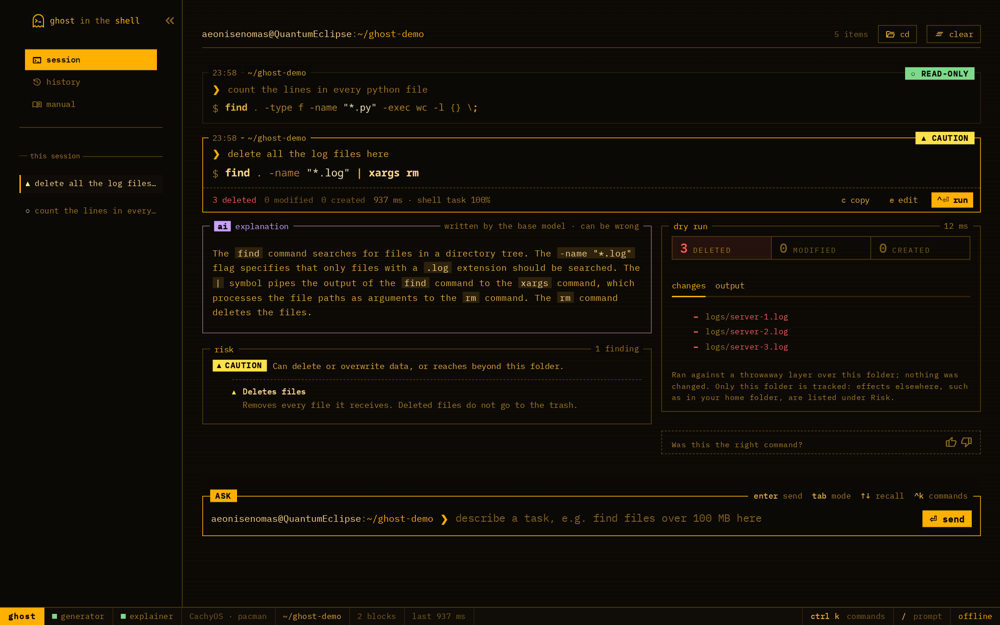
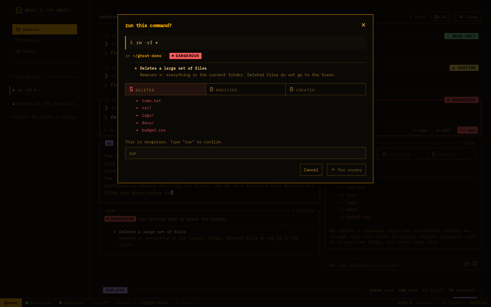
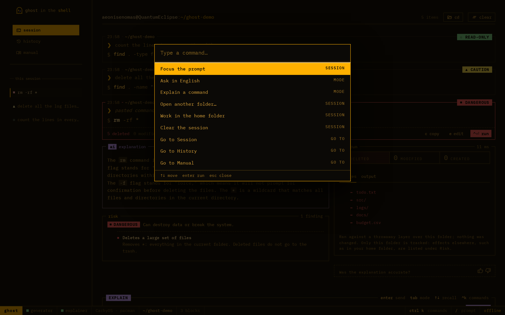
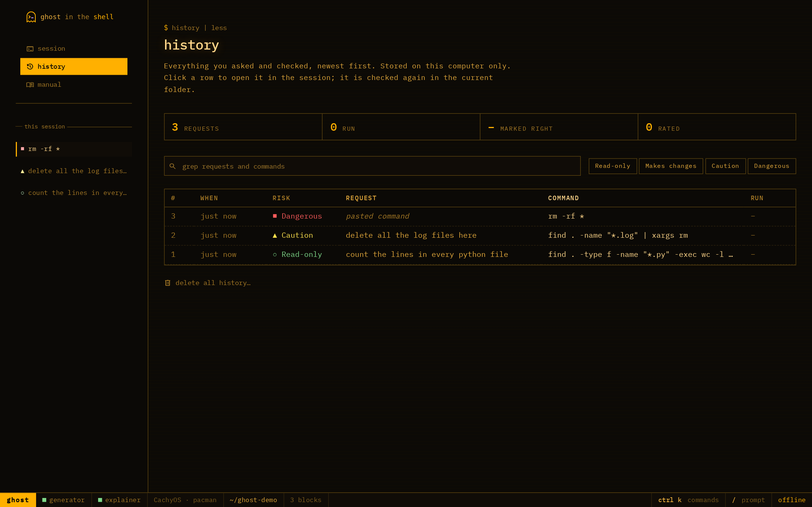
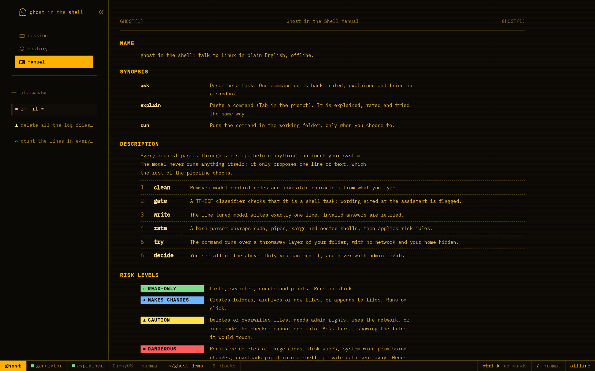

<p align="center">
  
</p>

<h1 align="center">ghost in the shell</h1>

<p align="center">
  Talk to Linux in plain English. Get one command, see exactly what it would do, then decide.<br>
  Runs entirely offline on an ordinary laptop CPU.
</p>

<p align="center">
  
  
  
  
</p>

<p align="center">
  
</p>

## Overview

Ghost in the Shell turns a request such as *"delete all the log files here"*
into a single shell command, and shows you everything you need to decide
whether to run it:

- **the command**, written by a fine-tuned Qwen2.5-Coder-1.5B;
- **what it does**, in plain English, written by a second model;
- **how risky it is**: Read-only, Makes changes, Caution or Dangerous, with
  the reasons, found by parsing the command rather than by asking a model;
- **a dry run** in a sandbox, listing every file the command would create,
  modify or delete, before anything happens to your system.

Nothing runs until you choose to. Dangerous commands need a typed
confirmation, and commands that need administrator rights are never run from
the app.

The project began as an NLP course project ("Fine-tuning small language
models"). How the model was trained and tested is in
[`docs/finetuning.md`](docs/finetuning.md).

## Features

| | |
|---|---|
| **Two modes** | *Ask* turns English into a command. *Explain* takes a command you found somewhere and explains, rates and dry-runs it. |
| **Risk rating** | A bash parser unwraps quoting tricks (`r''m`), `sudo`, `env`, `xargs`, `find -exec`, nested shells and pipes into interpreters before applying rules, so a dangerous command cannot hide behind a wrapper. |
| **Dry run** | The command runs with [bubblewrap](https://github.com/containers/bubblewrap) over a throwaway layer of your folder: no network, home folder hidden, the rest of the system read-only, five-second limit. Works on folders of any size. |
| **Run proportional to risk** | Read-only commands run on click; Caution opens a dialog listing the files it touches; Dangerous also needs the word `run` typed. The backend enforces this independently of the interface. |
| **Prompt-injection defences** | Model control tokens and invisible characters are stripped from requests; wording aimed at the assistant ("ignore previous instructions") is flagged; a classifier stops requests that are not shell tasks. |
| **Terminal-native interface** | Laid out like a full-screen terminal program, in amber on black: square panes with titles in their borders, reverse video for the selection, one typeface. Explanation streamed as it is written, Ctrl+K command palette, history, a `man`-style manual, keyboard first. |
| **Private by design** | Two local models served by llama.cpp on 127.0.0.1; history in a local SQLite file; no network use at all. |

<table>
  <tr>
    <td width="50%"></td>
    <td width="50%"></td>
  </tr>
  <tr>
    <td width="50%"></td>
    <td width="50%"></td>
  </tr>
</table>

## How it works

```
 request ──► clean ──► gate ──► write ──► validate ──► rate ──► dry run ──► you decide
             │          │         │          │           │          │
             │          │         │          │           │          └ bubblewrap, overlay over the folder,
             │          │         │          │           │            no network, home hidden, 5 s limit
             │          │         │          │           └ bashlex parse, unwrap wrappers, risk rules
             │          │         │          └ bash -n, program installed, right distribution;
             │          │         │            two more samples if the first answer is invalid
             │          │         └ fine-tuned Qwen2.5-Coder-1.5B, constrained to one line
             │          └ TF-IDF + logistic regression: is this a shell task?
             │            plus detection of wording aimed at the model
             └ strip chat control tokens and invisible characters
```

The model never runs anything. It proposes one line of text, and everything
after it is ordinary, testable code. Details, including the threat model and
the interface design, are in [`docs/app.md`](docs/app.md).

## Results

**The model.** Qwen2.5-Coder-1.5B was fine-tuned with QLoRA on 49,489 request
and command pairs from four public datasets, filtered for wrong answers,
synthetic tasks and rarely used tools. It is compared with the same base model
exported the same way, on two test sets where every command is run in a
sandbox and judged by what it does:

| | App requests (169) | NL2SH-ALFA (274) |
|---|---|---|
| Base Qwen2.5-Coder-1.5B | 68.6% | 47.1% |
| Fine-tuned | 72.8% | 50.0% |
| McNemar p | 0.34 | 0.41 |

- **App requests** are short tasks of the kind the app is built for, written
  for this project ([`evaluation/app_requests`](evaluation/app_requests)).
- **NL2SH-ALFA** is a public benchmark of longer, more formal prompts
  ([`evaluation/nl2sh_alfa`](evaluation/nl2sh_alfa)).

The fine-tuned model is ahead on both by 3 to 4 points. With test sets of this
size that gain is not statistically significant. It also always replies with a
bare command, where the base wraps a quarter of its replies in extra text.
Details and limitations are in [`docs/finetuning.md`](docs/finetuning.md).

**The app.** The request gate accepts all 300 NL2SH-ALFA test prompts and stops
all 30 handwritten off-topic requests. A request takes about 1 s on a 2014
laptop CPU (i7-4712HQ), of which the dry run takes 50 to 250 ms.

## How to run

### Requirements

- Linux, with [bubblewrap](https://github.com/containers/bubblewrap) (`bwrap`) and
  [llama.cpp](https://github.com/ggml-org/llama.cpp) (`llama-server`) on the `PATH`
- Python 3.12 or newer and [uv](https://docs.astral.sh/uv/)
- About 3 GB of free memory and 2.5 GB of disk for the models

| Distribution | bubblewrap | llama.cpp |
|---|---|---|
| Arch Linux | `sudo pacman -S bubblewrap` | `sudo pacman -S llama-cpp` |
| Debian, Ubuntu | `sudo apt install bubblewrap` | prebuilt binaries from the [llama.cpp releases](https://github.com/ggml-org/llama.cpp/releases) |
| Fedora | `sudo dnf install bubblewrap` | prebuilt binaries from the [llama.cpp releases](https://github.com/ggml-org/llama.cpp/releases) |

### 1. Get the code and dependencies

```bash
git clone https://github.com/AeonisEnomas/ghost-in-the-shell.git
cd ghost-in-the-shell
uv sync
```

### 2. Get the models

The app needs three files in `models/`.

**The explainer** (base Qwen2.5-Coder-1.5B, about 1.1 GB):

```bash
uv run hf download Qwen/Qwen2.5-Coder-1.5B-Instruct-GGUF qwen2.5-coder-1.5b-instruct-q4_k_m.gguf --local-dir models
mv models/qwen2.5-coder-1.5b-instruct-q4_k_m.gguf models/qwen2.5-coder-1.5b.Q4_K_M.gguf
```

**The command writer** (fine-tuned Qwen2.5-Coder-1.5B, about 1 GB). Open
[`finetune/finetune.ipynb`](finetune/finetune.ipynb) in Google
Colab with a T4 GPU and run all cells. Preparing the data takes about 5
minutes and training about 2.5 hours; if the session disconnects, run all
cells again and training resumes. The notebook saves
`qwen2.5-coder-1.5b-finetuned.Q4_K_M.gguf` to Google Drive; download it into
`models/`. It also saves `qwen2.5-coder-1.5b-base-export.Q4_K_M.gguf`, which
only the model tests need.

**The request classifier** (about 10 seconds; downloads Dolly-15k on first run):

```bash
uv run python classifier/train_classifier.py
```

### 3. Start the app

Run it from the folder you want to work in:

```bash
cd ~/some/project
uv run --project ~/path/to/ghost-in-the-shell ghost-in-the-shell
```

Open <http://localhost:8501>. The first start takes a few seconds while the
two models load. The app is reachable from this computer only.

| Key | Action |
|---|---|
| `Enter` | send the request |
| `Tab` | switch between Ask and Explain |
| `↑` `↓` | recall earlier requests |
| `Ctrl` `K` | command palette |
| `Ctrl` `Enter` | run the selected command (still asks first when it is risky) |
| `e`, `c` | edit or copy the selected command |
| `/` | jump to the prompt |

### Configuration

| Variable | Default | Purpose |
|---|---|---|
| `GHOST_MODELS_DIR` | `models/` in the project | where the model files are |
| `GHOST_THREADS` | up to 4 | CPU threads per model |
| `XDG_STATE_HOME` | `~/.local/state` | history and model logs go in `ghost-in-the-shell/` under it |

### Tests

```bash
uv run pytest                                    # 230 unit, integration and interface tests of the app
uv run --with playwright python tests/browser_check.py shots/   # with the app running: every flow in Chromium
```

Most tests run against the real models and the classifier, so complete step 2 first.

### Testing the model

Both tests compare the fine-tuned model with its base and take a few minutes
each on a laptop CPU (saved answers are reused):

```bash
cd evaluation/app_requests && uv run python run.py
cd ../nl2sh_alfa && uv run python run.py
```

## Project layout

```
src/ghost_in_the_shell/   the app
  sanitize.py      untrusted text: control tokens, hidden characters, terminal escapes
  relevance.py     request classifier and injection-phrase detection
  model.py         the two llama.cpp servers: writer and explainer
  context.py       system facts, folder listing, syntax check
  safety.py        bash parsing and risk rules
  sandbox.py       overlay dry run and the real run
  pipeline.py      the steps above, and the rules for running
  history.py       local SQLite history
  ui/              Streamlit interface, custom components, theme
tests/             tests of the app (pytest) and the browser check
finetune/          the fine-tuning notebook and the records of the run
evaluation/        tests of the model: base against fine-tuned
  app_requests/    169 app-style requests, their sample folder and scorer
  nl2sh_alfa/      the public benchmark, its test filesystems and scorer
classifier/        training script and data for the request classifier
data/nl2sh_alfa/   the NL2SH-ALFA training and test splits
docs/              app.md, finetuning.md
models/            model files (not in the repository; see "Get the models")
```

## Limitations

- The model gives exactly the right result for about three quarters of
  everyday requests and half of the harder benchmark prompts; some of its
  other answers are valid alternatives that do something slightly different.
  Read the explanation and the dry run.
- The risk check follows rules. It handles the usual tricks, but an unusual
  command can still be rated too low. Unknown programs are never rated
  read-only.
- The dry run tracks the working folder only; effects elsewhere appear under
  Risk. Commands run without a terminal: interactive programs get no input,
  and each command runs in a fresh shell, so `cd` does not persist.
- Linux only, because the sandbox relies on bubblewrap.

## Data and acknowledgements

- [NL2SH-ALFA](https://huggingface.co/datasets/westenfelder/NL2SH-ALFA)
  (Westenfelder et al., NAACL 2025, MIT): training and test data, included in
  `data/nl2sh_alfa/`
- [Bash Instruct III](https://huggingface.co/datasets/Frost2o24/bash-instruct-III-55k)
  (MIT), [mecha-org/linux-command-dataset](https://huggingface.co/datasets/mecha-org/linux-command-dataset)
  (Apache 2.0) and [aelhalili/bash-commands-dataset](https://huggingface.co/datasets/aelhalili/bash-commands-dataset)
  (MIT): additional training data
- [InterCode-ALFA](https://github.com/westenfelder/InterCode-ALFA) (MIT): the
  test filesystems used by the scorer
- [databricks-dolly-15k](https://huggingface.co/datasets/databricks/databricks-dolly-15k)
  (CC BY-SA 3.0): non-shell requests for the classifier, downloaded on demand
- [Qwen2.5-Coder](https://huggingface.co/Qwen/Qwen2.5-Coder-1.5B-Instruct)
  (Apache 2.0), fine-tuned with [Unsloth](https://github.com/unslothai/unsloth)
- [llama.cpp](https://github.com/ggml-org/llama.cpp), [bubblewrap](https://github.com/containers/bubblewrap),
  [bashlex](https://github.com/idank/bashlex), [Streamlit](https://streamlit.io)
- IBM Plex fonts (SIL Open Font License), bundled in `src/ghost_in_the_shell/ui/static/fonts/`
